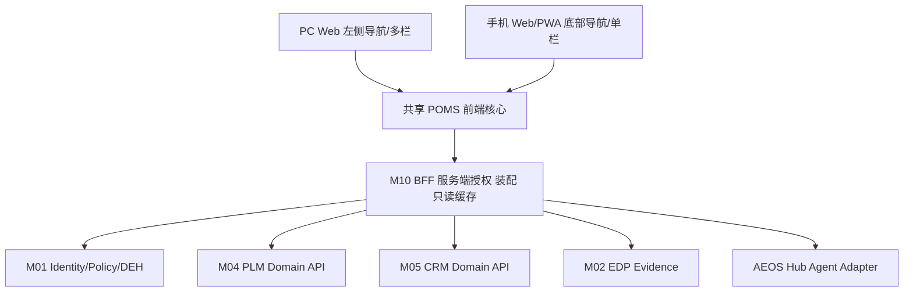

# 双端架构、契约及 PLM 数据接入

- UI 单套业务状态与组件，响应式布局；移动拍照、扫码、语音优先，Web 做岗位批量管理与能力包审批。
- BFF 负责 Identity/Policy 校验、校验租户/业务权限、限流、幂等、统一错误处理；浏览器严禁存长期业务令牌/Hub Runtime Secret。
- M04 PLM 已知前端接口来自 `plm-frontend/src/api/project.js` 和 `progress.js`：GET /api/v1/projects；GET /api/v1/projects/{id}；GET /api/v1/rd/tracking；GET /api/v1/rd/sheets/meta；GET /api/v1/rd/sheets/{type}；GET /api/project/{projectId}/nodes；GET /api/project/nodes/{nodeId}/evidence。路径基于源码定义，**不代表生产端点已连通**。
- 一期只读：授权后查询项目、本人相关项目节点与工作表。二期写回须经 PLM Domain API，形成 Result submitted，再由有权人 Verify，Evidence 由 M02 归档。M10 不得直接操作 PLM 数据库、以个人配置替代权限，或复制专业检验规则。
## 建议 BFF API（候选，待 M01/M04 Owner 签批）
GET /poms/v1/me/manifest
GET /poms/v1/me/actions
POST /poms/v1/roles/proposals
POST /poms/v1/roles/{id}/assemble
GET /poms/v1/capability-packs
GET /poms/v1/plm/projects
GET /poms/v1/plm/projects/{id}/nodes
POST /poms/v1/results (必须 idempotency_key/trace_id/evidence_refs)
GET /poms/v1/agents
POST /poms/v1/agents/{id}/sessions (通过 Hub Guard)
所有响应须带 data_as_of、source_system、connectivity_mode=live|mock|unavailable。未确认路径不得直接宣称正式 API。
